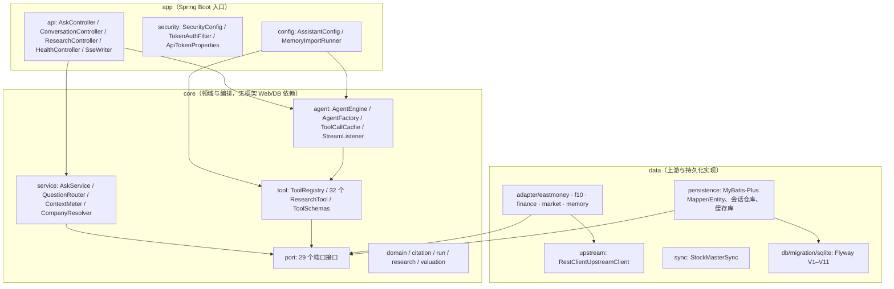
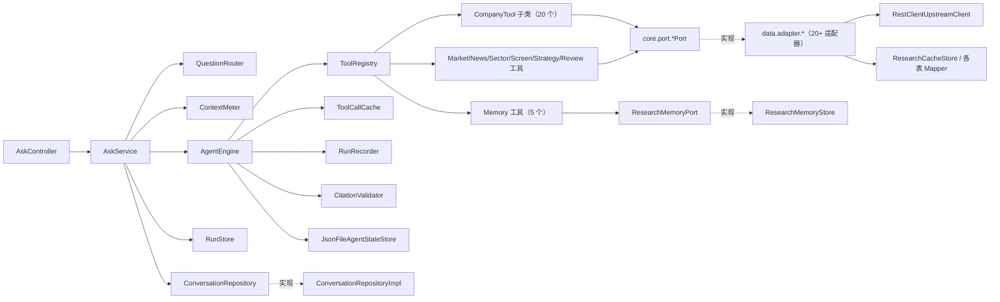
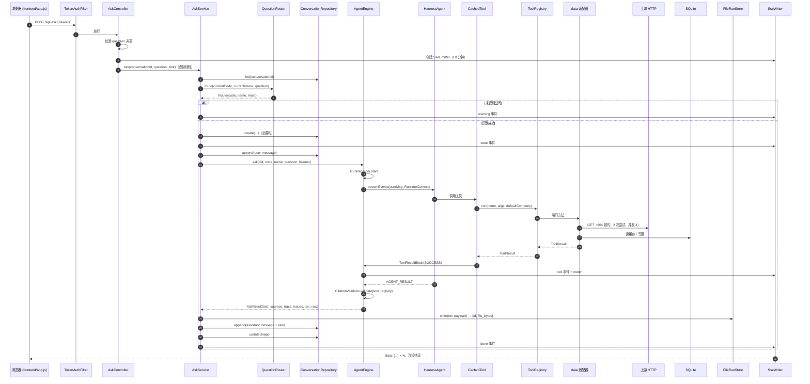
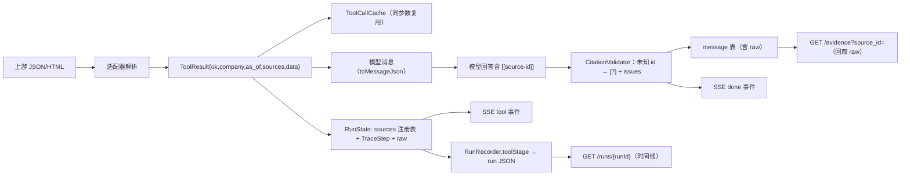

# 架构

## 1. 分层与依赖方向

Maven 三模块，端口—适配器（hexagonal）风格：

依赖规则（`app/.../ModuleBoundaryTest`，ArchUnit 强制）：

1. `core` 不依赖 `data`、`app`。
2. `data` 不依赖 `app`。
3. `core` 不出现 Web、MyBatis、JDBC 类型。
4. `io.agentscope..` 只允许出现在 `core.agent`。

装配点只有 `app/config/AssistantConfig`：它把 `data` 的适配器注入 `core` 的工具/服务。`core` 里所有外部能力都走 `core.port`。

## 2. 模块依赖图（类级别，主要节点）

## 3. 启动装配

`Application.main` 先创建 `${APP_DATA_DIR:./var}`，再启动 Spring。

| Bean | 位置 | 作用 |
| --- | --- | --- |
| `askExecutor` | `app.api.ApiConfig` | `newVirtualThreadPerTaskExecutor()`，SSE 工作线程 |
| `toolSchemas` | `AssistantConfig` | `ToolSchemas.loadDefault()` 读 `/tool-schemas.json` |
| `companyResolver` | `AssistantConfig` | 包 `CompanyDirectory`（data 的 `StockDirectoryAdapter`） |
| `toolRegistry` | `AssistantConfig` | 按 Python 顺序注册 32 个工具 |
| `agentProperties` | `AssistantConfig` | 读 `APP_SKILLS_DIR` / `APP_DATA_DIR`；默认模型 `deepseek:deepseek-v4-flash`、`maxTurns=10` |
| `runStore` | `AssistantConfig` | `FileRunStore(dataDir/runs)`，保留 200 份 |
| `questionRouter` / `contextMeter` | `AssistantConfig` | 路由与占用估算 |
| `assistantEngine` | `AssistantConfig` | 有 `DEEPSEEK_API_KEY` → `AgentFactory.create(...)`；否则 `UnavailableEngine` |
| `askService` | `AssistantConfig` | 编排 |
| `securityFilterChain` | `app.security.SecurityConfig` | 令牌过滤、无状态、公开路径 |
| `upstreamClient` | `data.config.UpstreamConfig` | `RestClientUpstreamClient` |
| Mapper 扫描 | `data.config.MybatisPlusConfig` | `@MapperScan("com.investmentresearch.data.persistence")` |
| `MemoryImportRunner` | `app.config` | `ApplicationRunner`，按 `APP_MEMORY_IMPORT` 导入旧档案 |
| `StockMasterSync.refresh` | `data.sync` | `@Scheduled(cron="0 0 6 * * *")` 每日 06:00 刷新股票主表 |

## 4. 核心业务调用序列（一次提问）

## 5. 关键数据流

### 5.1 工具结果 → 引用 → 回答

### 5.2 上下文占用

`ContextMeter.usage` = `FIXED_TOKENS`（system.md + tool-schemas.json 的固定成本）+ 消息文本估算 + 每消息 4 tokens 开销 ×（消息数+2）+ 当前草稿估算。预算 `BUDGET_TOKENS=55_000`，硬上限 `HARD_TOKENS=80_000`（只上报，实际由 harness `triggerTokens(80_000)` 触发压缩）。SSE 的 `meter` 事件按 ≥400ms 节流。

### 5.3 会话切换

- 问题里出现公司（六位代码优先，其次名称，名称更长者优先）→ `Route.code` 为该代码；与当前会话 `primaryCode` 不同则 `reset=true`，开新会话并提示「已切换到 …」。
- 问题里出现大盘词且没有点名公司（或只有「它/该股」这类指代词）→ `Route.code="MARKET"`，同样开新会话。
- 都没有 → 保留当前会话；无当前会话 → warning，不建会话。

## 6. 数据抓取、处理、存储分别在哪

| 环节 | 位置 |
| --- | --- |
| 抓取 | `data/adapter/**`，统一走 `data/upstream/RestClientUpstreamClient`（RestClient + JDK HttpClient，禁代理、Mozilla UA、60s、最多 2 次、全局并发 4） |
| 解析/清洗 | 各适配器内部；共享工具类 `EastmoneySupport`、`DatacenterSupport`、`ValuationSupport`（eastmoney）、`F10Support`、`FinanceSupport`、`MarketSupport`，测试侧还有 `EastmoneyTestSupport`/`F10TestSupport` |
| 纯计算 | `core/research/**`（市场分类、新闻、板块、筛选、策略、复盘）与 `core/valuation` |
| 持久化 | `data/persistence/**`：MyBatis-Plus Mapper 做 CRUD，JdbcTemplate/TransactionTemplate 做 upsert、动态 SQL、多语句事务 |
| 进程内缓存 | 各适配器的 `ConcurrentHashMap` 短 TTL；`ToolCallCache` 按会话缓存工具结果（17 个时效性工具除外），有容量与 30 分钟 TTL 上限 |
| 文件 | `var/runs/*.json`（运行原文）、`var/sessions/**`（AgentScope 状态）、`var/workspace/`（harness 工作区） |
| 数据库 | `var/app.db`（Flyway V1–V11） |

## 7. 架构问题与技术债（代码可见）

| 问题 | 证据 | 影响 |
| --- | --- | --- |
| `AgentEngine` 是 694 行的上帝类：装配、事件映射、缓存、引用、运行记录、中间件全在一起 | `core/agent/AgentEngine.java` | 改一处事件映射要读全文件；单测靠 `ScriptedModel` 兜 |
| 工具层重复小工具方法：`CompanyTool` 与 `ResolveCompanyTool` 各有一套 int/text 解析；两个 memory 工具各有一份 map 强转 | `CompanyTool.java:132-156`、`ResolveCompanyTool.java:72-94`、`AppendResearchRecordTool.java:60`、`UpdateResearchRecordTool.java:40` | 改参数语义要改两处 |
| `AgentEngine` 的 `TOOL_RESULT_END` 分支有两段几乎相同的 trace/stage/事件代码 | `AgentEngine.java:284-339` | 容易只改一段 |
| `ContextMeter` 为了校验完整解析一遍 `tool-schemas.json` 再丢弃 | `ContextMeter.java:61` | 启动多一次 JSON 解析，无害 |
| `ToolCallCache` 曾无容量/TTL 上限（已修：每会话 200 条 / 500 会话 / 30 分钟 TTL，LRU 淘汰） | `ToolCallCache.java` | 长会话内存增长已受控；500 个会话同时活跃时才会驱逐未删的旧会话 |
| `FileRunStore.prune` 把目录里所有 `*.json` 都当运行文件 | `FileRunStore.java:100` | 目录里放别的 JSON 会被误删 |
| 路由用宽泛子串匹配大盘词（“市场”“新闻”“政策”…） | `QuestionRouter.java:21-35` | 无关问题可能被路由成大盘会话 |
| `ConversationController` 每个请求多次 `find`/`messages` 扫描，无事务 | `ConversationController.java:100,116,133,189,245` | 会话消息多时重复查询 |
| 静态资源白名单与前端文件列表硬编码耦合 | `SecurityConfig.java:20-33` | 新增文件容易 401 |
| `data` 模块 17.7k 行、20+ 适配器，缺一层统一的「按域取数」抽象 | `data/adapter/**` | 各适配器各自实现缓存/新鲜度/分页 |
| 没有 CI 配置；质量门禁靠本地 `mvn verify` + spotless | 仓库无 `.github/` | 回归依赖人工 |
